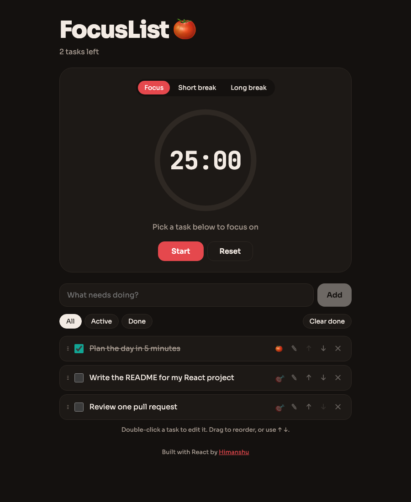

# 🍅 FocusList

> A to-do list with a built-in **Pomodoro timer**. Pick a task, hit start, and each finished focus session adds a 🍅 to that task. Built with React 19 hooks (`useReducer`, custom hooks) and tested with Vitest.

**🔗 Live demo:** https://himanshuuem.github.io/focuslist/

[](https://github.com/himanshuuem/focuslist/actions/workflows/deploy.yml)




## ✨ Features

- **Tasks:** add, complete, **double-click to edit** (<kbd>Enter</kbd> saves, <kbd>Esc</kbd> cancels), delete and clear completed.
- **Reorder** by **drag and drop** (native HTML5 DnD) or with accessible ↑ ↓ buttons.
- **Filters:** All, Active and Done, with the choice remembered.
- **Pomodoro timer:** Focus 25, Short break 5 and Long break 15, with an SVG progress ring, a chime made with the Web Audio API and a live countdown in the tab title.
- **Focus mode:** 🎯 a task to link it to the timer. Each completed focus session increments that task's 🍅 count.
- **Persistence:** tasks and the filter are saved to `localStorage` and survive reloads.

## 🧠 Engineering notes

- **`useReducer`**: every task change is a pure action (`add`, `toggle`, `edit`, `move`, `reorder`, `pomodoro`, `clearDone`) in [`tasksReducer.js`](src/tasksReducer.js), which is trivial to unit test.
- **`usePomodoro`**: a custom hook that counts down to a **target timestamp** instead of counting ticks, so it stays accurate when the browser throttles background tabs. It's tested with Vitest fake timers.
- **`useLocalStorage`**: a reusable hook that degrades gracefully when storage is blocked.

## 🧪 Tests

There are 9 tests: reducer edge cases (blank input, bounds, unknown actions), the timer hook with fake timers and completion callback, and UI flows (add, complete, filter, persist; inline edit; selecting a focus task). GitHub Actions runs the tests, builds and deploys to Pages.

## 🚀 Run Locally

```bash
git clone https://github.com/himanshuuem/focuslist.git
cd focuslist
npm install
npm run dev
npm test
```

## 📚 Origin

This builds on the **To-Do List** and **React Hooks** lessons from [The Complete Web Development Bootcamp](https://www.udemy.com/course/the-complete-web-development-bootcamp/), with a reducer, a custom timer hook and drag-and-drop added.

---

Made by [Himanshu](https://github.com/himanshuuem)
